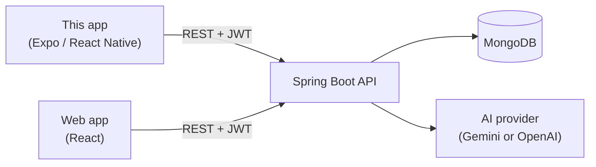

# One Percent: React Native App

Mobile app for **One Percent**, a self-development app for habit tracking and reflective journaling, with personalised feedback from a large language model. Built as my final year project (BSc Computer Science, Birmingham City University, 2025).

This repo is the frontend. The API, including the AI and embedding logic, lives here: **[fyp_one_percent_spring (Spring Boot)](https://github.com/kailau1/fyp_one_percent_spring)**

## Features

The phone version of the One Percent web app, with the same design (colours, Figtree and Literata, light and dark) and the same features:

- **Today:** greeting, the last twelve weeks as a ribbon of days (and what your days this year compound to), today's habits, today's entry, recent entries, the tip of the day, and a pointer to last week's reflection
- **Journal:** server-side search, entries grouped by month, drafts saved on the phone as you type, AI writing prompts, theme chips you can correct, sharing an entry, and **AI feedback** under each entry
- **Habits:** standard habits and *"When I **[trigger]**, I will **[action]**"* habits, ticking off today, current and longest streaks, and a 15-week history
- **Insights:** the themes your journal keeps coming back to, month by month, and **your week read back to you** every Monday, in your own words
- **What One Percent knows:** exactly what the AI is told about you, with facts you can add or delete and switches for each kind of context
- **Account:** time zone (follows the phone), System/Light/Dark, export of the whole journal as Markdown or PDF, log out

## How it fits together



All AI calls go through the backend, so no API keys are shipped in the app.

## Tech stack

Expo SDK 58 · React Native 0.88 · React 19 · Expo Router · TypeScript (strict) · TanStack Query · React Hook Form + Zod · react-native-svg · lucide icons · Jest 30 + Testing Library 14 + MSW

## Project structure

```
src/app/             Routes only (Expo Router): the tabs, entry, habit, week and about-you screens
src/features/<x>/    Each feature: api.ts (calls) → hooks.ts (TanStack Query) → screens and components
src/components/      Shared building blocks (Text, Button, Field, Sheet, ErrorState, …)
src/theme/tokens.ts  The design tokens: the web app's exact colours, fonts, radii and spacing
src/api/             API client, session (token in SecureStore), types (shared with the web app)
src/test/            Test setup and the fake backend (MSW handlers shared with the web app)
```

Pure logic (types, streaks, dates, trends, drafts, Markdown export) is copied unchanged from the web app, so both apps behave the same.

## Running locally

### Prerequisites
- Node.js 22.13+ and npm
- **Expo Go** on your phone, updated to a version that supports SDK 58
- The [backend](https://github.com/kailau1/fyp_one_percent_spring) running on your computer

### 1. Install
```bash
npm install
```

### 2. Let your phone reach the backend
The app reads the API address from `extra.BASE_URL` in `app.json`. It must be your computer's **local network IP** (find it with `ipconfig`), not `localhost`.

If the backend runs inside **WSL2** (Windows), your phone can't reach it by default. Once, in an administrator PowerShell:

1. Put this in `%UserProfile%\.wslconfig`:
   ```
   [wsl2]
   networkingMode=mirrored
   ```
2. Allow the ports through the firewall, then restart WSL:
   ```powershell
   Set-NetFirewallHyperVVMSetting -Name '{40E0AC32-46A5-438A-A0B2-2B479E8F2E90}' -DefaultInboundAction Allow
   New-NetFirewallRule -DisplayName "One Percent dev" -Direction Inbound -Protocol TCP -LocalPort 8084,8082 -Action Allow
   wsl --shutdown
   ```

### 3. Start the app
```bash
npx expo start --port 8082
```
Scan the QR code with Expo Go.

For a quick look in a browser instead: `EXPO_PUBLIC_API_URL=http://localhost:8084 npx expo start --web --port 8085` (the backend must allow that origin: start it with `--app.cors.allowed-origins=http://localhost:5173,http://localhost:8085`). Logins don't survive a page reload there, because browsers have no secure storage.

## Checks

```bash
npm run check   # lint + typecheck + tests
```
