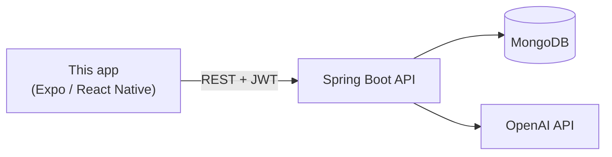

# One Percent: React Native App

Mobile app for **One Percent**, a self-development app for habit tracking and reflective journaling, with personalised feedback from a large language model. Built as my final year project (BSc Computer Science, Birmingham City University, 2025).

This repo is the frontend. The API, including the AI and embedding logic, lives here: **[fyp_one_percent_spring (Spring Boot)](https://github.com/kailau1/fyp_one_percent_spring)**

## Features

- **Login and sign-up** with JWT auth; sessions persist on the device with AsyncStorage
- **Dashboard:** personalised greeting, an AI-generated tip of the day, today's habits, and two ways to start journaling
- **Journaling:** write on a blank page or choose from **AI-generated prompts tailored to your habits and recurring themes**
- **AI feedback** on entries, rendered as Markdown
- **Two kinds of habit:**
  - Standard habits (e.g. *Name + Description*)
  - Trigger → action habits based on implementation intentions: *"When I **[trigger]**, I will **[action]**"*
- **Habit tracking:** colour-coded habits, daily completion, history view, and **current and longest streaks**

## How it fits together



All AI calls go through the backend, so no API keys are shipped in the app.

## Tech stack

React Native 0.76 · Expo SDK 52 · Expo Router · TypeScript · React Context API · AsyncStorage · React Native Paper · react-native-markdown-display

## Project structure

```
app/                 Screens and routing (Expo Router)
  auth/              Login and sign-up
  main/              Dashboard, journals, habits
components/          Reusable UI and modals (habit, journal entry, history)
context/             Global state: user, habits, journals
scripts/services/    API clients for users, habits, journals and AI
scripts/calculateStreak.ts   Current and longest streak calculation
```

## Running locally

### Prerequisites
- Node.js and npm
- The Expo Go app on your phone (or an Android/iOS emulator)
- The [backend](https://github.com/kailau1/fyp_one_percent_spring) running on your machine

### 1. Clone and install
```bash
git clone https://github.com/kailau1/fyp_one_percent
cd fyp_one_percent
npm install
```

### 2. Point the app at your backend
The app reads the API address from `extra.BASE_URL` in `app.json`. Your phone needs your computer's **local network IP**, not `localhost`.

Find it with `ipconfig` (Windows) or `ifconfig` / `ip addr` (macOS/Linux), then update `app.json`:

```json
"extra": {
  "BASE_URL": "http://<your-local-ip>:8084"
}
```

### 3. Start the app
```bash
npx expo start --tunnel
```
Scan the QR code with Expo Go, or press `a` / `i` to open an emulator.

## What I'd improve next

- Add component and service tests.
- Add unit tests for the streak calculation.
- Better offline and error states when the API is unreachable.
